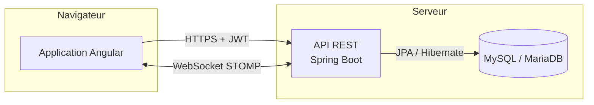
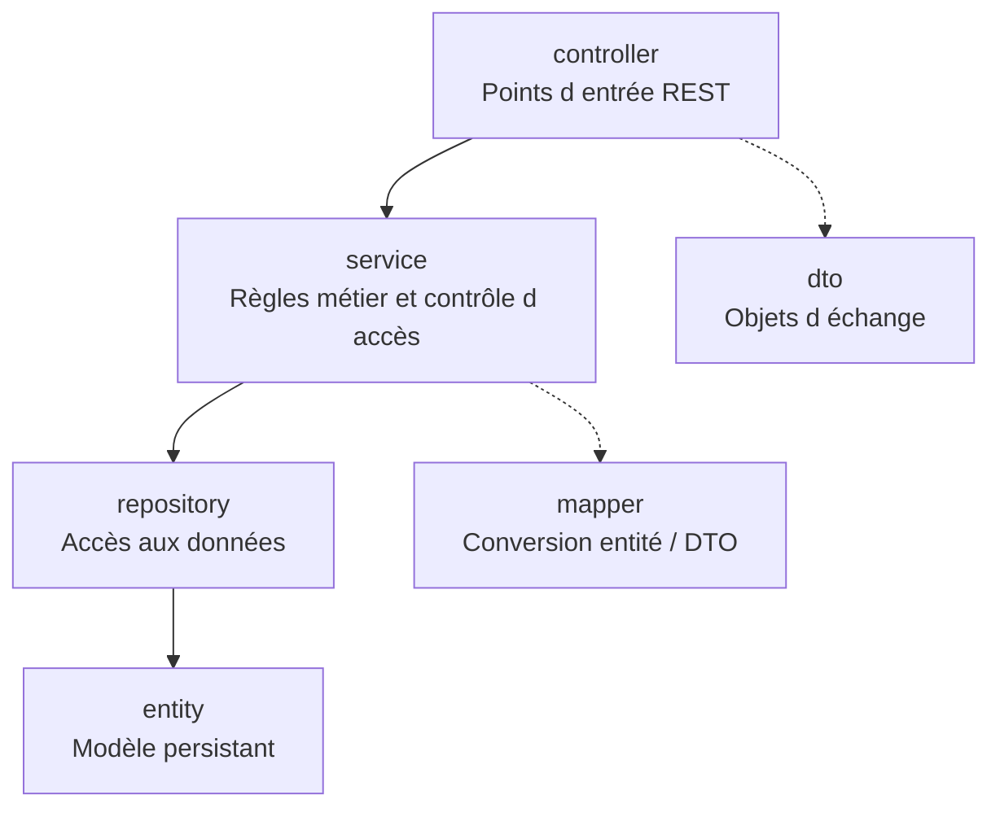
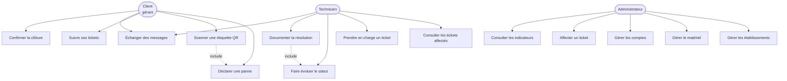
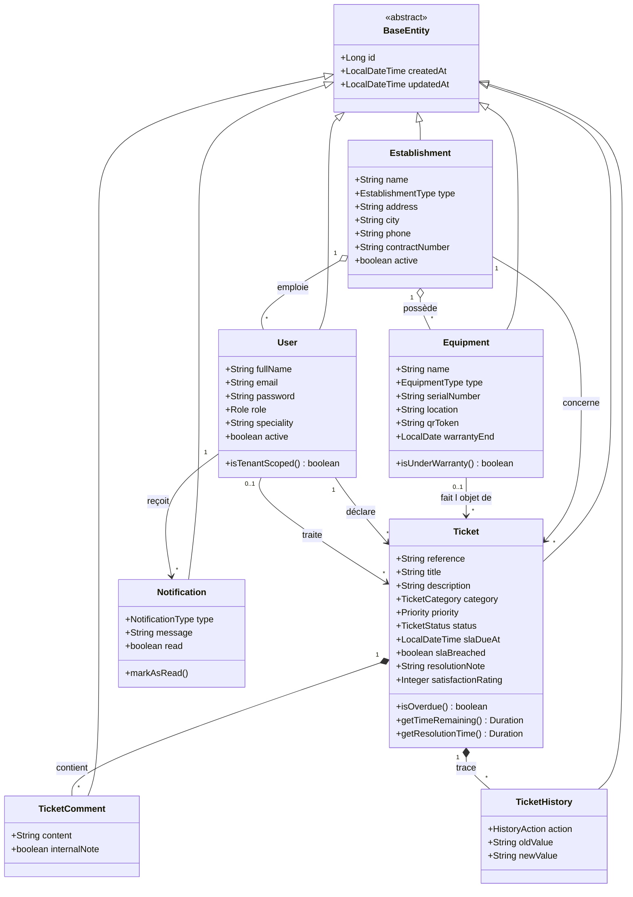
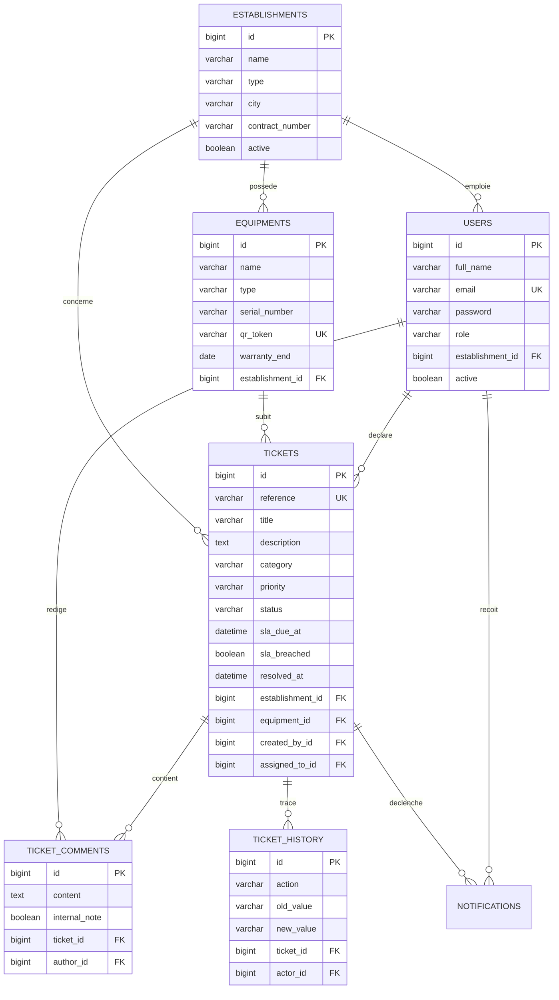
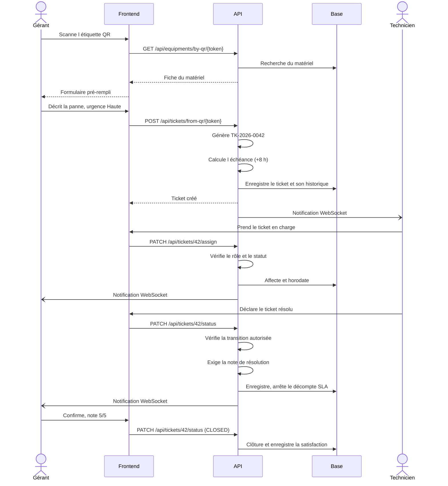
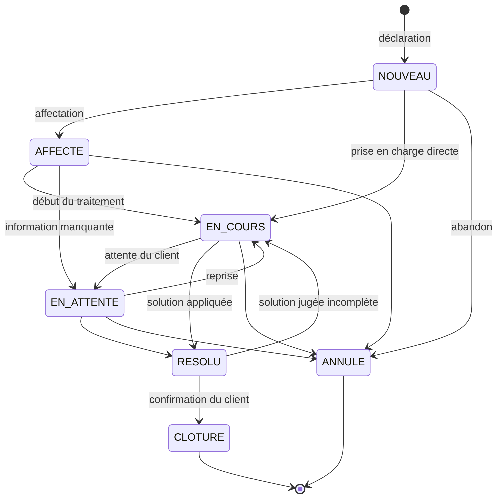
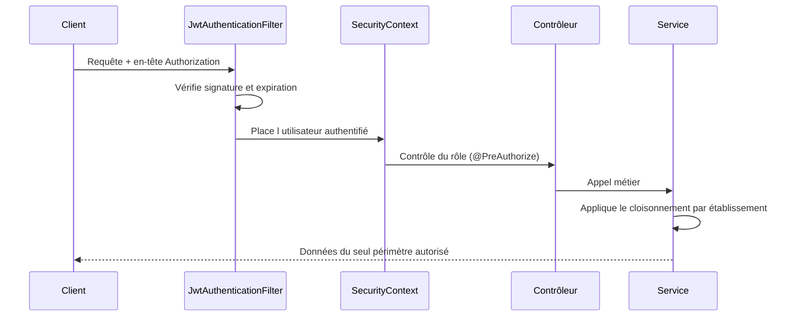

# Dossier de conception

**Projet :** Système de gestion des tickets d'assistance — ISET Gabès

Les diagrammes de ce document sont écrits en **Mermaid**. Ils s'affichent
directement sur GitHub et dans VS Code (extension *Markdown Preview Mermaid
Support*), et peuvent être exportés en image pour le rapport depuis
[mermaid.live](https://mermaid.live).

---

## 1. Architecture générale



L'application suit une architecture **client-serveur découplée** : le frontend et
le backend sont deux applications distinctes qui ne communiquent que par une API
REST. Ce découplage permet d'ajouter plus tard une application mobile consommant
la même API, sans rien modifier côté serveur.

### Couches du backend



**Principe directeur :** aucune règle métier dans les contrôleurs. Un contrôleur
valide le format de la requête et délègue. Toutes les décisions — qui a le droit
de voir quoi, quelle transition est permise — sont prises dans la couche service.
Un nouveau point d'entrée ne peut donc pas contourner une règle par oubli.

---

## 2. Diagramme de cas d'utilisation



---

## 3. Diagramme de classes



### Choix de conception commentés

| Choix | Justification |
|---|---|
| `BaseEntity` abstraite | Les dates de création et de modification concernent toutes les entités ; les centraliser évite de les répéter et de les oublier |
| `Establishment` porte le cloisonnement | Une seule relation à suivre pour savoir si un utilisateur a le droit de voir une donnée |
| `qrToken` distinct de l'identifiant | L'étiquette collée sur une machine ne doit pas révéler la numérotation interne de la base |
| `TicketHistory` séparée des commentaires | L'historique est une piste d'audit produite par le système ; les commentaires sont une conversation entre personnes |
| `internalNote` sur le commentaire | Permet une seule table d'échanges au lieu de deux, le filtrage se faisant à la lecture |
| Transitions portées par l'énumération | La règle vit à côté de la donnée qu'elle contraint, et le serveur peut les publier au frontend |

---

## 4. Modèle physique des données



### Index

Les colonnes les plus souvent filtrées portent un index, afin que les listes et le
tableau de bord restent rapides lorsque le volume augmente :

| Table | Index | Requête servie |
|---|---|---|
| `tickets` | `status` | Liste filtrée par statut |
| `tickets` | `priority` | Liste filtrée par urgence |
| `tickets` | `establishment_id` | Cloisonnement par client |
| `tickets` | `assigned_to_id` | Tickets d'un technicien |
| `tickets` | `sla_due_at` | Surveillance des échéances |
| `notifications` | `recipient_id, is_read` | Compteur de notifications non lues |

---

## 5. Diagramme de séquence : déclaration et résolution d'une panne



---

## 6. Diagramme d'états du ticket



Ces transitions sont déclarées dans l'énumération `TicketStatus`, méthode
`allowedTransitions()`. Le serveur les publie au frontend dans le champ
`allowedTransitions` de chaque ticket : l'interface n'affiche donc que les actions
réellement possibles, sans dupliquer la règle.

---

## 7. Sécurité

### 7.1 Chaîne d'authentification



### 7.2 Mesures retenues

| Risque | Mesure |
|---|---|
| Vol de mot de passe en base | Empreinte BCrypt avec sel différent par compte |
| Falsification de jeton | Signature HMAC vérifiée à chaque requête |
| Accès aux données d'un autre client | Filtre imposé dans la couche service à partir du compte, jamais depuis la requête |
| Découverte de l'existence d'une ressource | Réponse 404 au lieu de 403 sur une ressource hors périmètre |
| Escalade par un paramètre d'URL | Le paramètre `establishmentId` est ignoré pour un compte client |
| Injection SQL | Requêtes paramétrées exclusivement (JPA) |
| Fuite d'informations techniques | Message générique au client, pile d'appels uniquement dans les journaux |
| Secrets dans le dépôt | Valeurs sensibles surchargeables par variables d'environnement |

---

## 8. Tests automatisés

| Suite | Portée | Vérifie |
|---|---|---|
| `TicketStatusTest` | Unitaire | Le cycle de vie : transitions autorisées, états finaux, absence de retour arrière |
| `JwtServiceTest` | Unitaire | Production, expiration et rejet d'un jeton signé avec une autre clé |
| `TenantIsolationIntegrationTest` | Intégration | Le cloisonnement, par de vraies requêtes HTTP sur une base H2 en mémoire |

Les tests d'intégration s'exécutent sur une base en mémoire : ils ne touchent pas
la base de développement et ne demandent aucun serveur MySQL démarré.

```bash
cd backend && ./mvnw test
```

---

ISET Gabès — Projet de Fin d'Études
